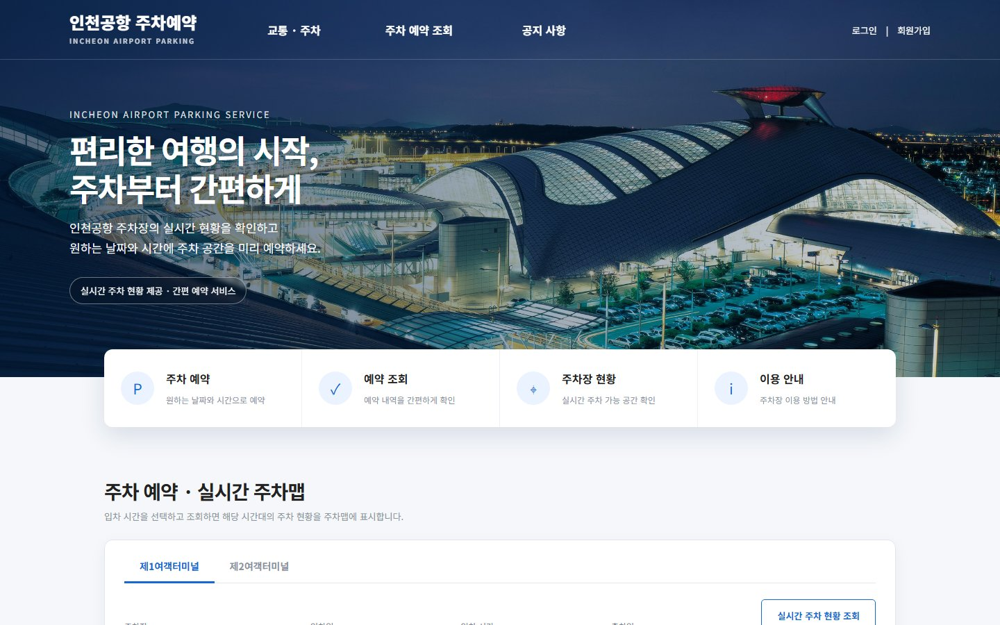
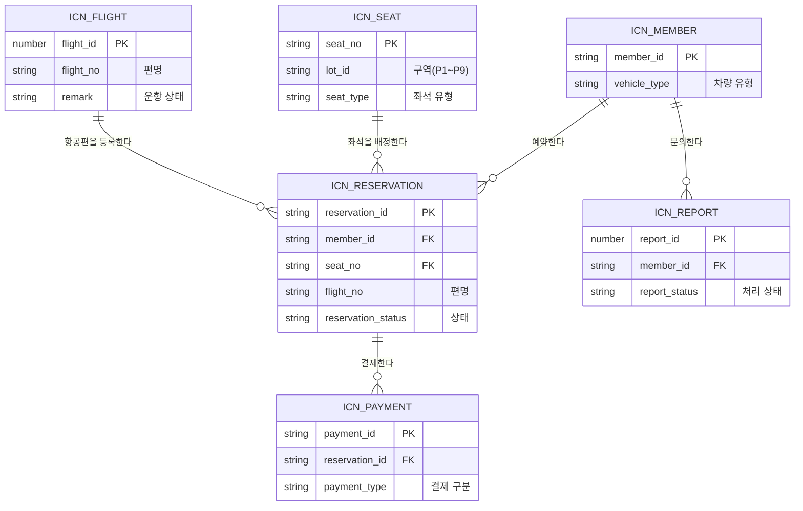

<div align="center">

# 인천공항 주차예약 · INCHEON AIRPORT PARKING

### 편리한 여행의 시작, 주차부터 간편하게.

인천국제공항 제1여객터미널 주차장을 실제 혼잡도·운항 현황과 연동해 예약하고 관리하는 웹 서비스

`Java 21` · `JSP / Servlet` · `JDBC` · `Oracle XE` · `Tomcat 9.0`

[日本語](README.md) · **한국어**

</div>



## 프로젝트 소개

「인천공항 주차예약」은 TEAM JK 가 개발한 「인천공항 제1여객터미널 주차 예약·관리 시스템」입니다. 공항 주차장을 출발 전에 예약하고, 출차할 때 정산할 수 있게 하는 것을 목표로 합니다.

공공데이터포털에 공개된 인천국제공항공사 오픈 API와 연동해, 주차장 혼잡도와 항공편 운항 현황을 실제 데이터로 다룹니다. 이용자는 예약할 때 탑승할 항공편을 등록할 수 있고, 그 항공편이 결항되면 시스템이 장기주차 전환과 좌석 재배정을 자동으로 처리합니다. 운영자는 관리자 콘솔에서 예약·회원·매출·문의를 확인할 수 있습니다.

## 팀 구성·담당

| 팀원 | 담당 영역 | 주요 담당 기능 |
| --- | --- | --- |
| 임정규 (`wjdrb1226-lab`) · 팀장 | 메인 화면·공지사항 | 메인 화면, 실시간 혼잡도 API, 공통 헤더, 공지사항, 안내 페이지, 최종 결제 연결 |
| 황희원 (`HuiwonHwang`) | 회원·마이페이지 | 회원 DB, 회원가입·로그인, 이메일 인증, 마이페이지, 예약 내역·취소 |
| 안병찬 (`anbyoungchan123`) | 주차맵·결항 대응 | 상세 주차맵, 좌석 DB, 결항 자동 재배정 |
| 오윤섭 (`oys2669`) | 예약·결제 | 결제, 예약 DB, 결제 페이지, 항공편 검색 연동, 최종 결제 |
| 강선구 (`khangkhang1`) | 관리자 콘솔·FAQ | 관리자 콘솔, FAQ, 문의·신고, 노션·회의록 관리 |

> ( ) 안은 GitHub 계정 이름입니다.

## 주요 기능

| 분류 | 기능 |
| --- | --- |
| 혼잡도 | 구역(P1~P9)별 주차 가능 대수·혼잡도 실시간 표시 |
| 예약 | 구역도에서 구역 선택, SVG 주차맵에서 좌석 지정, 차량 유형(일반·전기차·장애인)에 따른 좌석 제한 |
| 항공편 | 실제 항공편 검색·등록, 결항 시 장기주차 자동 전환, 뒤 예약 자동 재배정 |
| 결제 | 예약금 결제, 출차 시 이용 시간에 따른 최종 정산, 예약 취소 |
| 회원 | 회원가입, 이메일 인증, 로그인·로그아웃, 아이디·비밀번호 찾기, 마이페이지, 예약 내역 |
| 공지·FAQ | 공지사항 목록·상세·첨부파일, FAQ 카테고리 필터, 이용 안내·요금 안내 |
| 문의 | 문의·신고 등록, 관리자 답변 |
| 관리자 | 대시보드, 예약·회원 관리, 좌석·구역 현황, 매출 통계(CSV 내려받기), FAQ·공지 관리 |
| 다국어 | 한국어 / 일본어 전환 |

## 설계 포인트

- **좌석의 "예약 상태"를 테이블에 두지 않습니다.** 예약의 시작~종료 시각과 조회 시간대가 겹치는지를 조회할 때마다 계산합니다. "지금 이용 중인 차"와 "내일 예약"을 구분하기 위해서입니다.
- **상태 전환에 스케줄러를 쓰지 않습니다.** 예약 시작 시각을 입차 시각으로 보고, 화면을 조회하기 직전의 UPDATE 로 "예약 완료"를 "주차 중"으로 바꿉니다.
- **예약과 결제를 한 트랜잭션으로 갱신합니다.** 출차 정산과 예약 취소에서 한쪽만 성공한 상태를 남기지 않기 위해서입니다.
- **비밀값을 소스 코드에 쓰지 않습니다.** DB 계정과 API 키는 `secret.properties` 에서 읽고, 이 파일은 저장소에 올리지 않습니다.

## 기술 스택

| 분류 | 기술 |
| --- | --- |
| Frontend | JSP, JSTL, EL, HTML5, CSS3, JavaScript, jQuery 1.8.1, SVG |
| Backend | Java 21, Servlet 4.0 |
| Database | Oracle Database XE, JDBC (ojdbc8) |
| Server | Apache Tomcat 9.0 |
| External API | 공공데이터포털(data.go.kr) 인천국제공항공사 오픈 API (주차장 현황·여객편 운항 현황) |
| Payment | PortOne (테스트 모드) |
| Library | cos.jar (파일 업로드), JavaMail (메일 발송) |
| Tools | Eclipse, Git / GitHub, Notion |

> 프레임워크 없이 프론트컨트롤러 패턴과 커맨드 패턴으로 구성했습니다. 요청은 `controller` 의 서블릿이 받고, `t_gubun` 파라미터 값에 따라 `command` 클래스로 처리를 넘깁니다.

## 데이터베이스 설계

주요 테이블과 관계는 다음과 같습니다. 테이블 이름은 `icn_` 로 시작합니다.



이 밖에 공지사항(`icn_notice`)과 FAQ(`icn_faq`) 테이블이 있습니다.

## 프로젝트 구성

```text
src/main
├── java
│   ├── controller    # 프론트컨트롤러 (Servlet)
│   ├── command       # 업무 처리 (기능별 패키지)
│   ├── dao           # DB 접근, 외부 API 호출
│   ├── dto           # 데이터 전달용 클래스
│   ├── service       # 주차 현황 집계
│   ├── common        # DB 접속, 요금 계산, 다국어, 설정 읽기
│   ├── mail          # 메일 발송
│   ├── messages_ko.properties / messages_ja.properties   # 화면 문구
│   └── secret.properties.example                         # 설정 파일 템플릿
└── webapp
    ├── index.jsp, common_header.jsp, common_footer.jsp
    ├── reservation   # 주차맵, 예약, 결제
    ├── member        # 회원, 마이페이지
    ├── notice / faq / report / guide / flight
    ├── manager       # 관리자 콘솔
    └── css / js / images
sql                   # 일부 테이블 DDL
```

## 실행 방법

### 필요한 환경

- Java 21
- Apache Tomcat 9.0
- Oracle Database XE
- Eclipse IDE for Enterprise Java and Web Developers
- 공공데이터포털(data.go.kr)에서 발급받은 인천국제공항공사 API 서비스키

### 1. 저장소 클론

```bash
git clone https://github.com/khangkhang1/team-jk.git
cd team-jk
```

### 2. 설정 파일 만들기

```bash
cp src/main/java/secret.properties.example src/main/java/secret.properties
```

만들어진 `secret.properties` 에 자신의 접속 정보를 입력합니다.

```properties
db.user=your-oracle-user
db.password=your-password
api.serviceKey=your-service-key
mail.from=your-address@gmail.com
mail.appPassword=your-app-password
```

DB 서버 주소를 바꾸려면 같은 방법으로 `db_local.properties.example` 에서 `db_local.properties` 를 만들고 `db.host` 를 입력합니다.

> `secret.properties` 와 `db_local.properties` 에는 비밀번호 등이 들어 있으므로 Git 에 커밋하지 마세요.

### 3. 데이터베이스 준비

Oracle 에 테이블을 만듭니다. `sql` 폴더에는 일부 테이블(FAQ·문의 등)의 DDL만 들어 있습니다.

### 4. 애플리케이션 실행

Eclipse 에 기존 프로젝트로 가져온 뒤 Tomcat 9.0 에 추가해 실행합니다.

브라우저에서 `http://localhost:8080/<프로젝트명>/ParkingStatus` 로 접속하면 메인 화면이 나옵니다.

## 개발 현황

2026년 8월부터 10월까지 5명의 팀 프로젝트로 개발했습니다. 현재 구현에는 다음과 같은 제한이 있습니다.

- 결제는 테스트 모드입니다. 실제 청구·환불은 일어나지 않습니다.
- 실시간 API는 현재 값만 주기 때문에, 미래 시간대의 주차 가능 대수는 임의 값입니다.
- 좌석 수는 실제 주차장보다 줄였습니다.
- 관리자 콘솔은 한국어만 지원합니다.

README 의 설명과 스크린샷은 팀에서 내용을 확인하면서 계속 고쳐 나갑니다.

---

<div align="center">

**인천공항 주차예약 — 편리한 여행의 시작, 주차부터 간편하게.**

</div>
