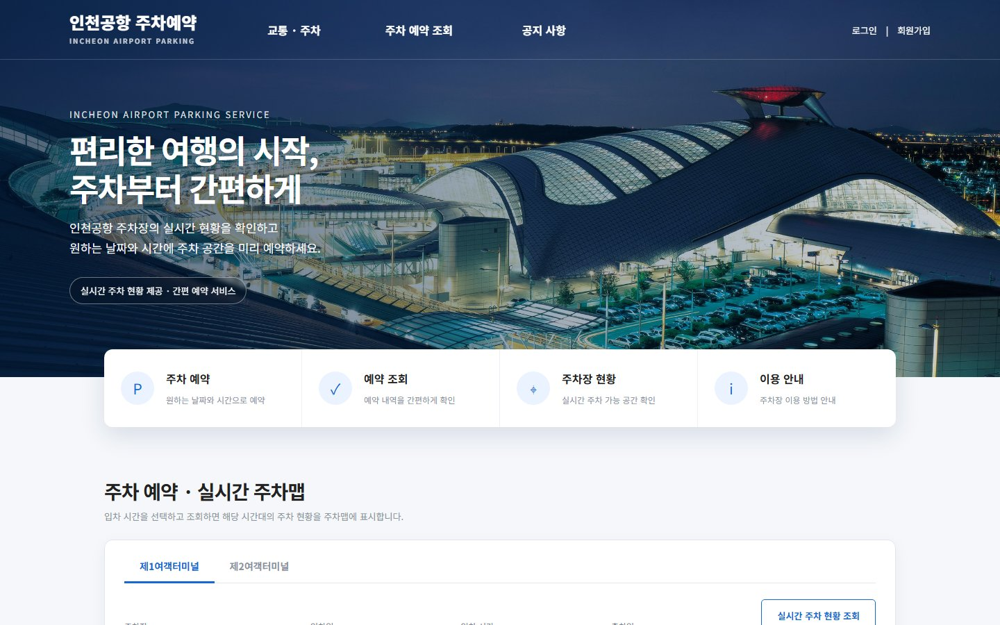
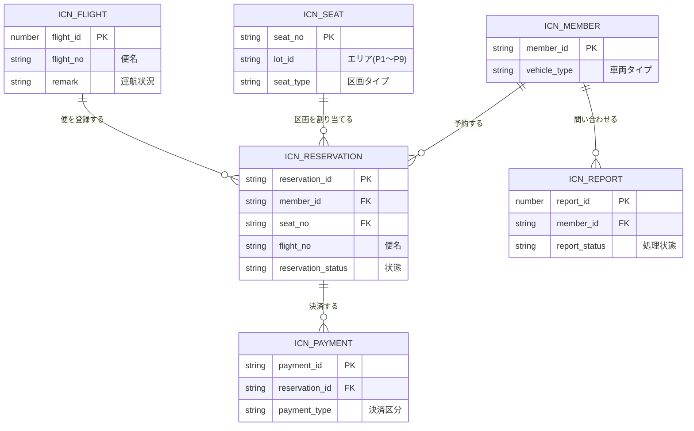

<div align="center">

# 仁川空港 駐車予約 · INCHEON AIRPORT PARKING

### 快適な旅のはじまりは、駐車の予約から。

仁川国際空港 第1旅客ターミナルの駐車場を、実際の混雑状況・運航状況と連携して予約・管理するWebサービス

`Java 21` · `JSP / Servlet` · `JDBC` · `Oracle XE` · `Tomcat 9.0`

**日本語** · [한국어](README.ko.md)

</div>



## プロジェクト紹介

「仁川空港 駐車予約」は、空港の駐車場を出発前に予約し、出庫時に精算できるようにすることを目的として開発しました。

公共データポータルで公開されている仁川国際空港公社のオープンAPIと連携し、駐車場の混雑状況とフライトの運航状況を実データで扱います。利用者は予約時に搭乗する便を登録でき、その便が欠航になった場合は、システムが長期駐車への切り替えと区画の再割当を自動で行います。運営側は、管理者コンソールで予約・会員・売上・お問い合わせを確認できます。

## チーム構成・担当

| メンバー | 担当領域 | 主な担当機能 |
| --- | --- | --- |
| カン・ソング (`kkang`) | 管理者コンソール・FAQ・お問い合わせ | 管理者コンソール(ダッシュボード、予約・会員管理、売上統計)、FAQ、お問い合わせ・通報、フライトAPI連携、多言語対応 |
| アン・ビョンチャン (`anbyoungchan123`) | 駐車マップ | SVGの駐車マップ、区画データ、欠航時の自動再割当 |
| オ・ユンソプ (`OhYunseop`) | 予約・決済 | 予約登録、予約金の決済、出庫時の最終精算、フライト検索の連携 |
| イム・ジョンギュ (`임정규`) | メイン画面・お知らせ | メイン画面、リアルタイム混雑状況API、共通ヘッダー、お知らせ、利用案内・料金案内 |
| ファン・ヒウォン (`HuiwonHwang`) | 会員 | 会員登録、ログイン、メール認証、ID・パスワードの再設定、マイページ、予約履歴・キャンセル |

> ( )内は、Gitコミット履歴に記録されている作成者名です。

## 主な機能

| 分類 | 機能 |
| --- | --- |
| 混雑状況 | エリア(P1〜P9)ごとの空き台数・混雑度のリアルタイム表示 |
| 予約 | エリア図からの区画選択、SVG駐車マップでの区画指定、車両タイプ(一般・電気自動車・障がい者用)に応じた区画の制限 |
| フライト | 実在する便の検索・登録、欠航時の長期駐車への自動切り替え、後続予約の自動再割当 |
| 決済 | 予約金の決済、出庫時の利用時間に応じた最終精算、予約キャンセル |
| 会員 | 会員登録、メール認証、ログイン・ログアウト、ID・パスワードの再設定、マイページ、予約履歴 |
| お知らせ・FAQ | お知らせの一覧・詳細・添付ファイル、FAQのカテゴリ絞り込み、利用案内・料金案内 |
| お問い合わせ | お問い合わせ・通報の登録、管理者による回答 |
| 管理者 | ダッシュボード、予約・会員管理、区画・エリア状況、売上統計(CSV出力)、FAQ・お知らせ管理 |
| 多言語 | 韓国語 / 日本語の切り替え |

## 設計のポイント

- **区画の「予約状態」をテーブルに持ちません。** 予約の開始〜終了時刻と照会する時間帯が重なるかどうかを、照会のたびに計算します。「いま利用中の車」と「明日の予約」を区別するためです。
- **状態の切り替えにスケジューラを使いません。** 予約開始時刻を入庫時刻とみなし、画面を照会する直前のUPDATEで「予約済み」から「駐車中」へ切り替えます。
- **予約と決済を1つのトランザクションで更新します。** 出庫時の精算と予約キャンセルで、片方だけが成功した状態を残さないためです。
- **機密情報をソースコードに書きません。** DBアカウントやAPIキーは `secret.properties` から読み込み、このファイルはリポジトリに含めません。

## 技術スタック

| 分類 | 技術 |
| --- | --- |
| Frontend | JSP, JSTL, EL, HTML5, CSS3, JavaScript, jQuery 1.8.1, SVG |
| Backend | Java 21, Servlet 4.0 |
| Database | Oracle Database XE, JDBC (ojdbc8) |
| Server | Apache Tomcat 9.0 |
| External API | 公共データポータル(data.go.kr) 仁川国際空港公社オープンAPI(駐車場状況・旅客便運航状況) |
| Payment | PortOne(テストモード) |
| Library | cos.jar(ファイルアップロード), JavaMail(メール送信) |
| Tools | Eclipse, Git / GitHub, Notion |

> フレームワークは使わず、フロントコントローラパターンとコマンドパターンで構成しています。リクエストは `controller` のServletが受け取り、`t_gubun` パラメータの値に応じて `command` のクラスへ処理を渡します。

## データベース設計

主なテーブルとリレーションは次のとおりです。テーブル名は `icn_` で始めています。



このほかに、お知らせ(`icn_notice`)とFAQ(`icn_faq`)のテーブルがあります。

## プロジェクト構成

```text
src/main
├── java
│   ├── controller    # フロントコントローラ(Servlet)
│   ├── command       # 業務処理(機能ごとのパッケージ)
│   ├── dao           # DBアクセス、外部API呼び出し
│   ├── dto           # データ受け渡し用クラス
│   ├── service       # 駐車状況の集計
│   ├── common        # DB接続、料金計算、多言語、設定読み込み
│   ├── mail          # メール送信
│   ├── messages_ko.properties / messages_ja.properties   # 画面文言
│   └── secret.properties.example                         # 設定ファイルの雛形
└── webapp
    ├── index.jsp, common_header.jsp, common_footer.jsp
    ├── reservation   # 駐車マップ、予約、決済
    ├── member        # 会員、マイページ
    ├── notice / faq / report / guide / flight
    ├── manager       # 管理者コンソール
    └── css / js / images
sql                   # 一部テーブルのDDL
```

## 実行方法

### 必要な環境

- Java 21
- Apache Tomcat 9.0
- Oracle Database XE
- Eclipse IDE for Enterprise Java and Web Developers
- 公共データポータル(data.go.kr)で発行した仁川国際空港公社APIのサービスキー

### 1. リポジトリをクローン

```bash
git clone https://github.com/khangkhang1/team-jk.git
cd team-jk
```

### 2. 設定ファイルを作成

```bash
cp src/main/java/secret.properties.example src/main/java/secret.properties
```

作成された `secret.properties` に、自分の接続情報を入力します。

```properties
db.user=your-oracle-user
db.password=your-password
api.serviceKey=your-service-key
mail.from=your-address@gmail.com
mail.appPassword=your-app-password
```

DBサーバーのアドレスを変える場合は、同じ方法で `db_local.properties.example` から `db_local.properties` を作成し、`db.host` を入力します。

> `secret.properties` と `db_local.properties` にはパスワードなどが含まれるため、Gitにコミットしないでください。

### 3. データベースを準備

Oracle にテーブルを作成します。`sql` フォルダには、一部のテーブル(FAQ・お問い合わせなど)のDDLだけを収録しています。

### 4. アプリケーションを起動

Eclipse に既存プロジェクトとしてインポートし、Tomcat 9.0 に追加して起動します。

ブラウザで `http://localhost:8080/<プロジェクト名>/ParkingStatus` にアクセスすると、メイン画面が表示されます。

## 開発状況

2026年8月から10月にかけて、5名のチームプロジェクトとして開発しました。現在の実装には、次の制限があります。

- 決済はテストモードです。実際の請求・返金は行いません。
- リアルタイムAPIは現在の値だけを返すため、未来の時間帯の空き台数は仮の値です。
- 区画の数は、実際の駐車場より少なくしています。
- 管理者コンソールは韓国語のみです。

READMEの説明とスクリーンショットは、チームで内容を確認しながら更新していきます。

---

<div align="center">

**仁川空港 駐車予約 — 快適な旅のはじまりは、駐車の予約から。**

</div>
